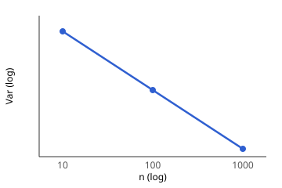

# L001 · [Example] Variance of the sample mean

> EXAMPLE lab showing the format. Delete it when real labs exist.

## Goal
Check $\operatorname{Var}(\bar x) = \sigma^2/n$ numerically ([[example-concept]]).

## Setup
$n \in \{10, 100, 1000\}$, $10^4$ repetitions, 5 seeds (`config.yaml`, `run.py`).

## Results

| $n$ | 10 | 100 | 1000 |
|---|---|---|---|
| $\operatorname{Var}(\bar x)$ | 0.100 | 0.010 | 0.001 |

## Conclusion
*Observed:* slope $-1.00 \pm 0.01$, matching the theory. **Next:** [[lab:2]].
